# Phase 3: Exploratory Data Analysis

**Data:** 7,422 leads created 2018-04-28 to 2018-11-14. **Target (working mapping):** High Potential = CONVERTED, In Progress Positive, Potential, Long Term; everything else, including Open, is Low. Overall High rate = **38.39%** (2,849 / 7,422).

Every number below comes from `scripts/run_eda.py` (full tables in `reports/phase3_eda_stats.md`). Rates carry 95% Wilson intervals. All findings are **associations in observational data, not causes**, and several may reflect how leads were handled rather than inherent lead quality; the Phase 4 leakage audit will test those.

## 1. Target and status mix
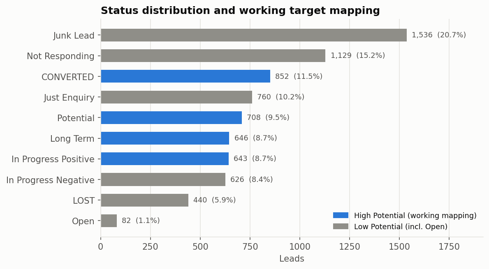

Junk Lead (1,536) and Not Responding (1,129) are the largest statuses; 852 leads are CONVERTED. Long Term (646) and In Progress Negative (626) are the ambiguous mapping choices. **Business reading:** about 20.7% of all leads are tagged Junk and another 15.2% Not Responding, so a large share of rep effort goes to leads that never engage.

## 2. Time
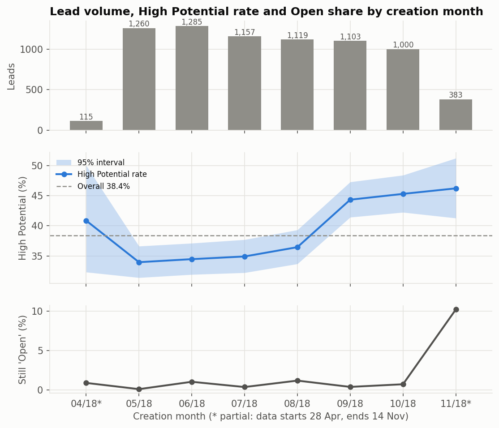

The High rate sits at 34-36.5% from May to August, then 44.3% (Sep), 45.3% (Oct) and 46.2% (Nov, partial). November's Open share jumps to 10.2% (about 1% or less earlier), a sign the newest leads are not yet resolved.

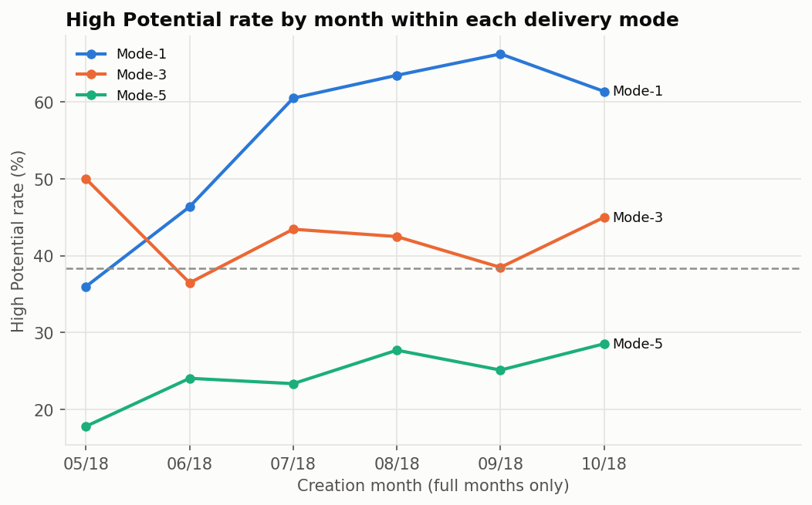

Part of the Aug-to-Sep jump is **mix shift**: Mode-5 (lowest-converting mode) fell from 65.5% of leads in August to 21.3% in September. But it is not only mix: within Mode-1 the High rate rose from 36.0% (May) to 60-66% (Jul-Oct), while Mode-3 stayed roughly flat and Mode-5 rose only a little (17.8% to 28.5%).
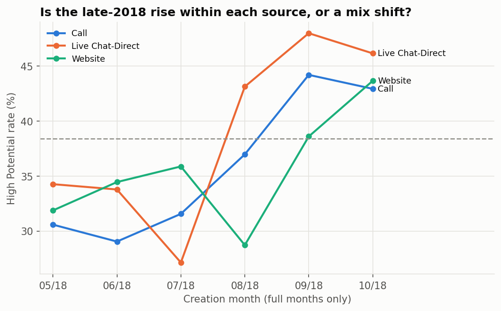

Within the three big sources the rate also rose from August on (e.g. Call 29-32% in May-Jul to 43-44% in Sep-Oct). **Implication:** the relationship between features and the target is not stable over time, so the final model must be validated on later months, not a random split.

## 3. Lead source
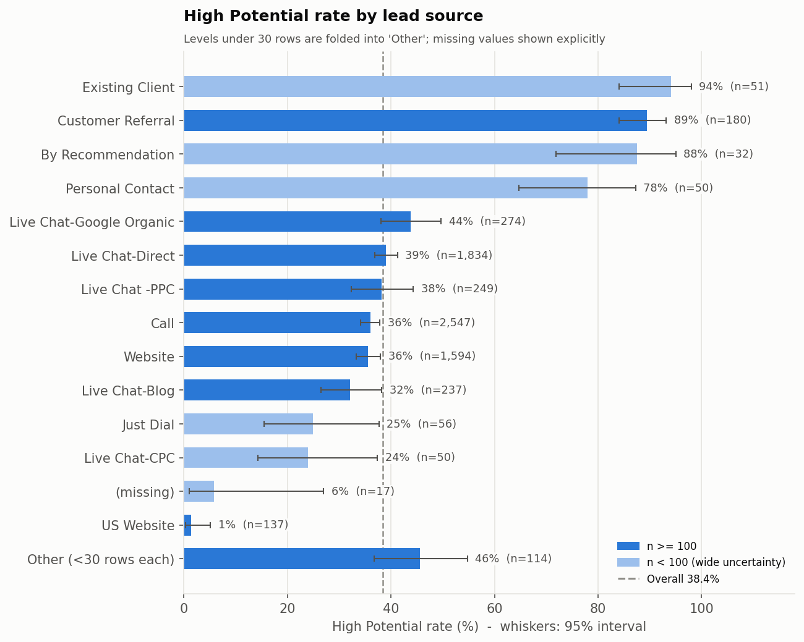

Referral-type sources are far above average: Customer Referral 89.4% (n=180), Existing Client 94.1% (n=51), By Recommendation 87.5% (n=32), Personal Contact 78.0% (n=50). **US Website is 1.5% (2 of 137)**. The three biggest channels sit close together (Call 36.0%, Live Chat-Direct 39.0%, Website 35.6%), so the large channels differ only modestly. Missing Source (n=17) is 5.9%, too small to read firmly. **Business reading:** referral sources are a small share of volume but convert at 2 to 2.5 times the overall rate, a candidate for protecting or growing.

## 4. Location, product, delivery mode
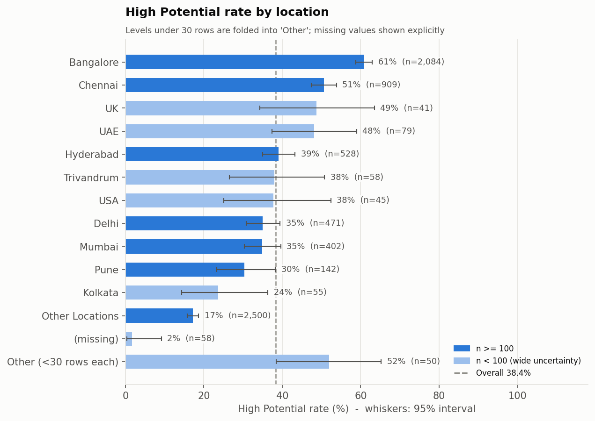
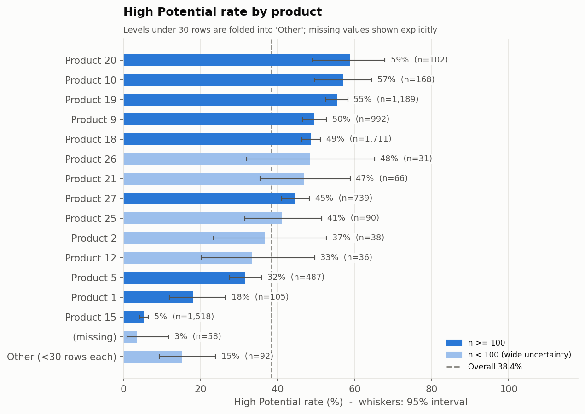
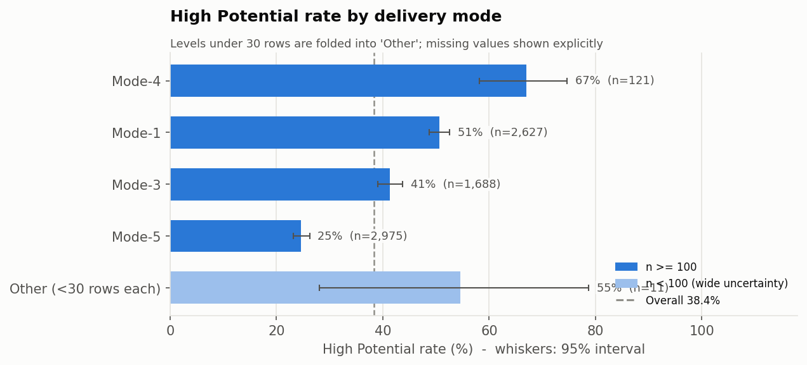

- **Location:** "Other Locations" (2,500 leads, 33.7% of volume) is only 17.2% High, versus Bangalore 60.9% (n=2,084) and Chennai 50.6% (n=909). What "Other Locations" actually contains is unknown.
- **Product:** Product 15 has **1,518 leads (20.5% of all) and only 80 High (5.3%)**, while the other large products range 31.6-55.4%. Product has the strongest association with the target of any single field.
- **Delivery mode:** Mode-5 is 24.6% on 2,975 leads, Mode-1 50.7% on 2,627, Mode-4 66.9% on only 121. The meaning of the modes is not documented.

## 5. Sales agents
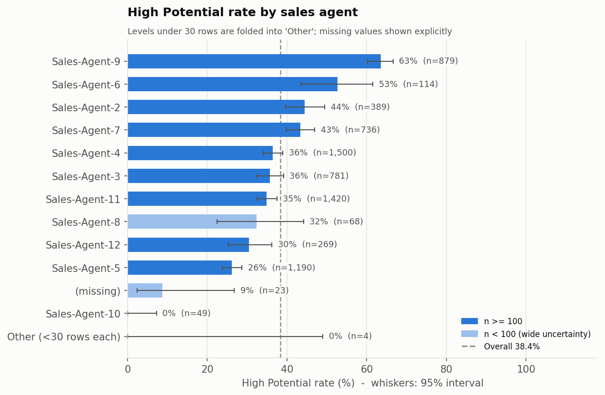

Agent rates range from 26.1% (Agent-5, n=1,190) to 63.5% (Agent-9, n=879), and Agent-10 has 0 High in 49 leads. These gaps are real in the data, but I have **not** tested whether leads were routed to agents by product, source or mode, so they must not be read as agent skill.

## 6. Source x delivery mode
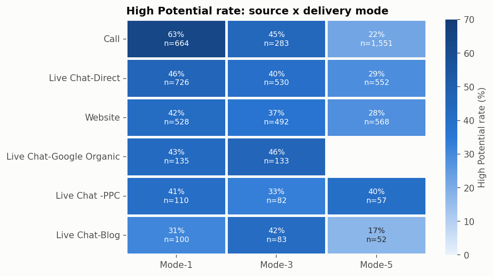

The mode effect holds across sources: Call is 63.3% in Mode-1 but 22.1% in Mode-5 (1,551 leads). Cells under 30 leads are blank (Google Organic x Mode-5 has 1 lead).

## 7. Data-completeness signals
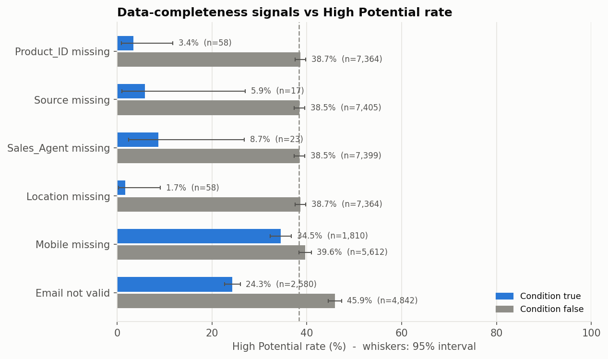

Rows with a missing Product_ID, Source, Sales_Agent or Location are almost never High (1.7-8.7%, but only 17-58 rows each). A non-valid email goes with 24.3% High (n=2,580) versus 45.9% with a valid email; missing Mobile goes with 34.5% versus 39.6%. These look like **data-entry or process artifacts** (fields filled at different stages), which makes them leakage candidates.

## 8. Association strength
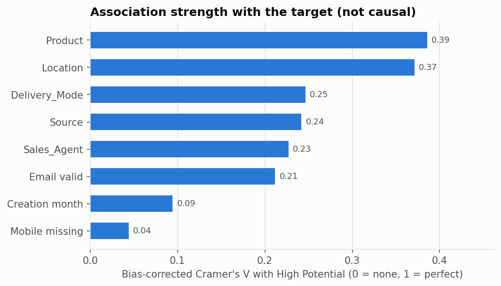

Bias-corrected Cramer's V with the target: Product 0.39, Location 0.37, Delivery_Mode 0.25, Source 0.24, Sales_Agent 0.23, Email valid 0.21, Creation month 0.10, Mobile missing 0.04. Fields with many levels and overlapping information (product, location and source are likely related) are not directly comparable, so this ranks candidates and does not measure independent importance.

## What this means for the next phases
1. Use a **time-ordered split** (train on earlier months, test on the latest), plus a random split only as a comparison.
2. Treat Delivery_Mode, Sales_Agent, email-valid and the missing-value flags as **leakage/process suspects** until the owner confirms when each is recorded.
3. Fold rare levels inside the pipeline and keep missing values as an explicit category (no rows dropped).
4. Report results with Open mapped to Low and, as a sensitivity check, mapped to High.

## Open questions for the project owner
- What do Mode-1 to Mode-5 and Product_ID values (especially Product 15) represent?
- What is in "Other Locations"?
- Is a lead assigned to a Sales_Agent before or after its quality is known, and how are leads routed?
- At what stage are email and mobile collected?

## Addendum (added in Phase 7): label maturity changes how the monthly trend should be read

Section 2 above treated the rise in High Potential rate from September onward as part real, part delivery-mode mix shift. A later check shows a third, probably larger factor: **statuses change as leads age**.

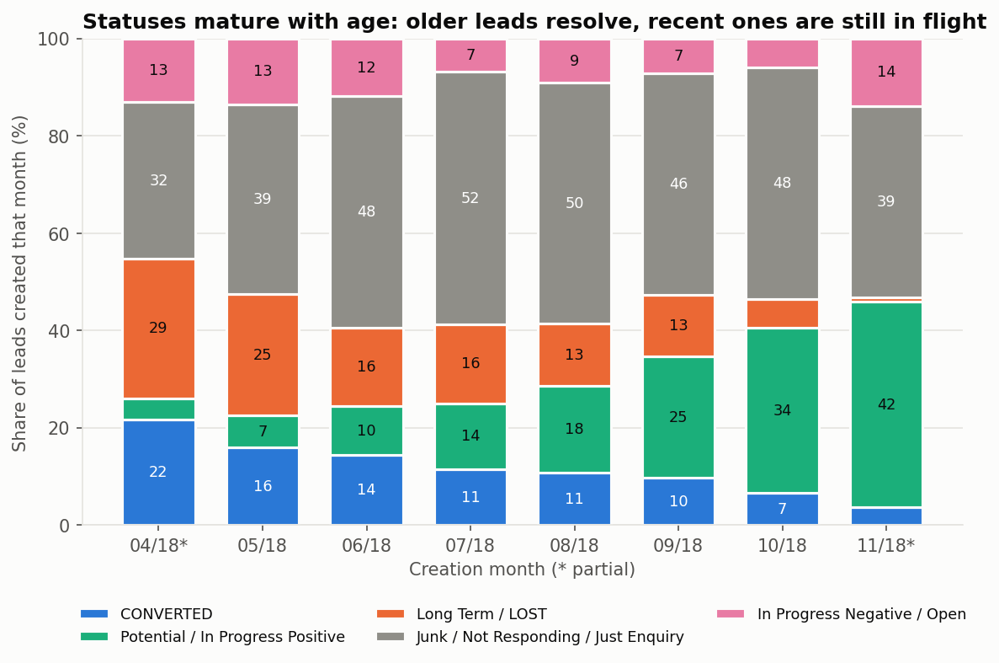

| Creation month | CONVERTED % | Potential + In Progress Positive % | Long Term + LOST % |
|---|---|---|---|
| Apr (partial) | 21.7 | 4.3 | 28.7 |
| May | 16.0 | 6.5 | 24.9 |
| Jun | 14.4 | 10.0 | 16.2 |
| Jul | 11.5 | 13.6 | 16.2 |
| Aug | 10.7 | 17.9 | 12.8 |
| Sep | 9.7 | 25.0 | 12.6 |
| Oct | 6.6 | 34.0 | 5.8 |
| Nov (partial) | 3.7 | 42.3 | 0.8 |

Older leads have had time to convert, go to Long Term, or be marked LOST; recent leads are still "Potential" or "In Progress Positive". Because the working target counts Potential and In Progress Positive as High, **recent months look better partly because their leads are unresolved, not because they are better leads**. This is right-censoring of the label.

Consequences carried into the rest of the project:
- The month-over-month High rate cannot be read as improving lead quality.
- The target mixes final outcomes (CONVERTED) with transient states, so a model trained on it partly learns "what status do leads of this kind have at snapshot time".
- Test-month labels (Oct-Nov) are less mature than training labels; ranking metrics held up (see Phase 6), but absolute rates and CONVERTED counts in the test months will change as those leads mature.
- Any pilot must define outcomes with a fixed maturity window and needs status-change timestamps, which this dataset does not contain.
